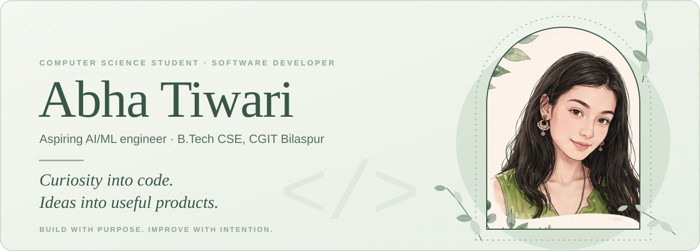
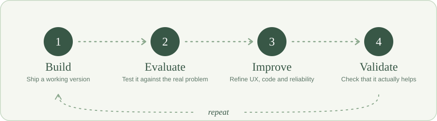
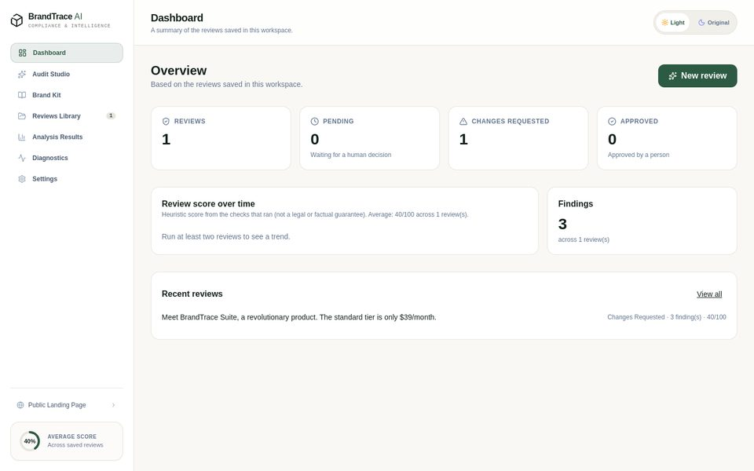
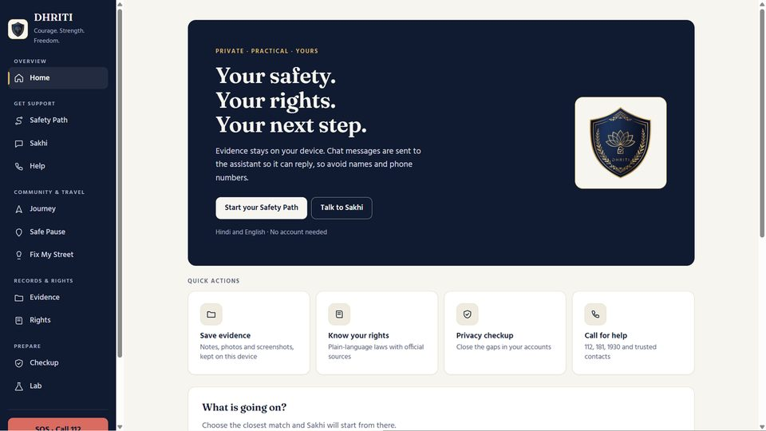
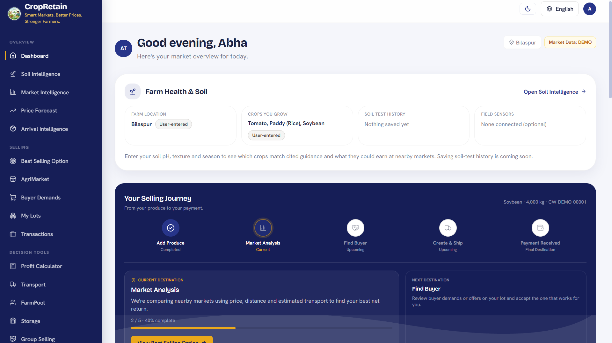
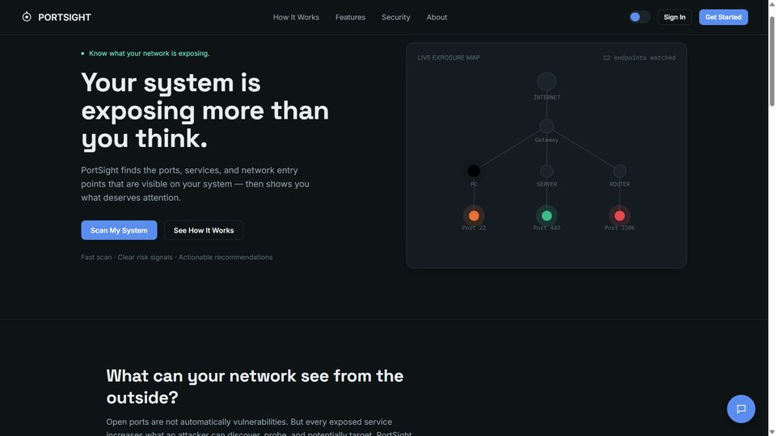
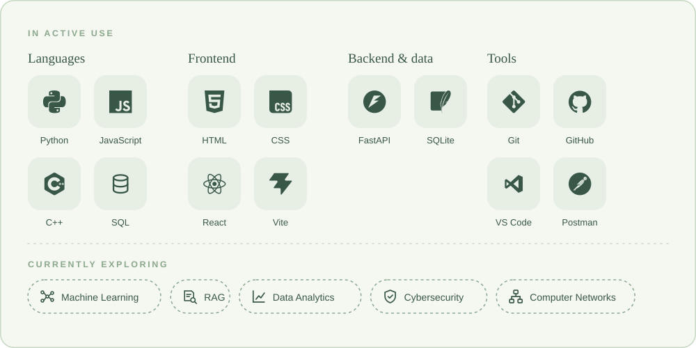
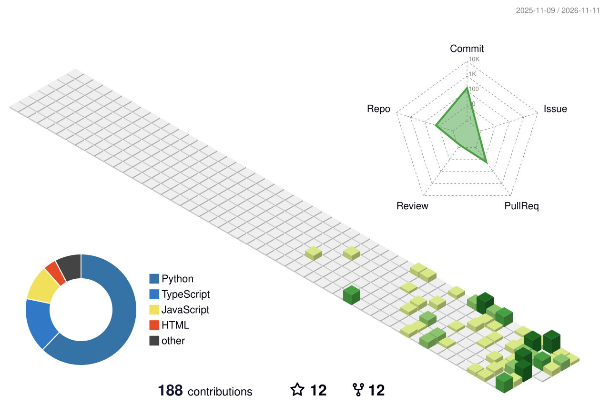

  

  

## About me

I'm a Computer Science student at CGIT Bilaspur who learns by building. I like to understand a problem properly before writing code for it, and I'm most curious about the place where software engineering meets applied AI. Right now that means building web applications end to end, then going back to improve them instead of moving on.

<table>
  <tr>
    <td><b>Studying</b></td>
    <td>B.Tech Computer Science and Engineering, CGIT Bilaspur (2025–2029)</td>
  </tr>
  <tr>
    <td><b>Focus</b></td>
    <td>Software development, with applied AI/ML as the main area I'm exploring</td>
  </tr>
  <tr>
    <td><b>Also exploring</b></td>
    <td>Data-driven systems, cybersecurity, computer networking</td>
  </tr>
  <tr>
    <td><b>Looking for</b></td>
    <td>Software development and AI/ML internships</td>
  </tr>
  <tr>
    <td><b>Before college</b></td>
    <td>Class topper in 12th (PCM); highest marks in Mathematics (98)</td>
  </tr>
</table>

## How I work

I treat every project as an evolving product, not a one-time assignment. A working interface or a live deployment isn't the finish line: I keep going back to find missing functionality, improve usability, tighten the architecture and check that the product really solves the problem it was built for.

  

That's why the projects below carry a status instead of a "done" label. Ongoing refinement is part of the process.

## Selected projects

Individual projects only. Each role below is based on the repository's commit history.

<table>
  <tr>
    <td width="50%" valign="top">
      
      <h3>BrandTrace AI</h3>
        
      Checks marketing copy against a brand's rules <i>before</i> it is published. Every finding quotes the exact text and cites the approved source, and a person makes the final approval decision.  
      <b>Problem:</b> inconsistent or non-compliant brand messaging reaching the public. 
      <b>My role:</b> sole author (all commits). 
      <b>Built with:</b> React, Vite, TypeScript, Express, SQLite, optional AI analysis.  
      <a href="https://github.com/Abha153/BrandTrace">Repository</a> · <a href="https://brandtrace-app.onrender.com">Live demo</a> (free tier, sample data)
    </td>
    <td width="50%" valign="top">
      
      <h3>Dhriti</h3>
        
      A calm first-response web app for women in India facing online harassment, stalking or unsafe journeys: a guided safety plan, verified helplines, an on-device evidence log and an AI guide limited to one verified data file.  
      <b>Problem:</b> people in distress need clear next steps, not a maze of information. 
      <b>My role:</b> sole author (all commits). 
      <b>Built with:</b> React, Vite, Node.js, Express.  
      <a href="https://github.com/Abha153/Dhriti">Repository</a>
    </td>
  </tr>
  <tr>
    <td width="50%" valign="top">
     

      <h3>CropRetain</h3>
        
      Helps farmers decide where, when and to whom to sell: mandi price comparison, forecasts, buyer matching, transport and storage coordination, in 15 interface languages.  
      <b>Problem:</b> small farmers often sell at the nearest price because comparing options is hard. 
      <b>My role:</b> primary author (most commits); one small dependency fix came from a collaborator. 
      <b>Built with:</b> FastAPI, React, Vite, Tailwind CSS, PostgreSQL.  
      <a href="https://github.com/Abha153/CropRetain">Repository</a>
    </td>
    <td width="50%" valign="top">
      
      <h3>PortSight</h3>
        
      A network exposure assessment tool that finds exposed ports, classifies risk by severity and generates reports. It has a safe demo mode and a restricted live scan limited to an allowlist.  
      <b>Problem:</b> small environments rarely have lightweight, continuous exposure checks. 
      <b>My role:</b> sole author (all commits). 
      <b>Built with:</b> Python, FastAPI, SQLAlchemy, SQLite, HTML/CSS/JS.  
      <a href="https://github.com/Abha153/PortSight-Network-Security-Exposure-Assessment">Repository</a>
    </td>
  </tr>
</table>

## Technology

  

## Currently learning and building

- Strengthening software engineering fundamentals and problem-solving.
- Building practical applications, then iterating on them.
- Exploring applied AI/ML, including retrieval-augmented generation (RAG).
- Learning system design and application architecture.
- Getting started with open-source collaboration.

## Contribution landscape

  

Generated from real GitHub activity by <a href="https://github.com/yoshi389111/github-profile-3d-contrib">github-profile-3d-contrib</a> and refreshed daily.

## Connect

  <a href="https://github.com/Abha153"> GitHub</a> &nbsp;·&nbsp;
  <a href="https://www.linkedin.com/in/abha-tiwari-74571a381/"> LinkedIn</a> &nbsp;·&nbsp;
  <a href="https://abha153.github.io/my_portfolio"> Portfolio</a> &nbsp;·&nbsp;
  <a href="https://leetcode.com/u/abha15/"> LeetCode</a> &nbsp;·&nbsp;
  <a href="https://www.hackerrank.com/profile/abha69528/"> HackerRank</a>

<h2 align="center">🌌 My Contribution Universe</h2>

  

 

<h2 align="center">⚡ Coding Consistency</h2>

  

 

<i>Build with purpose. Improve with intention.</i>

